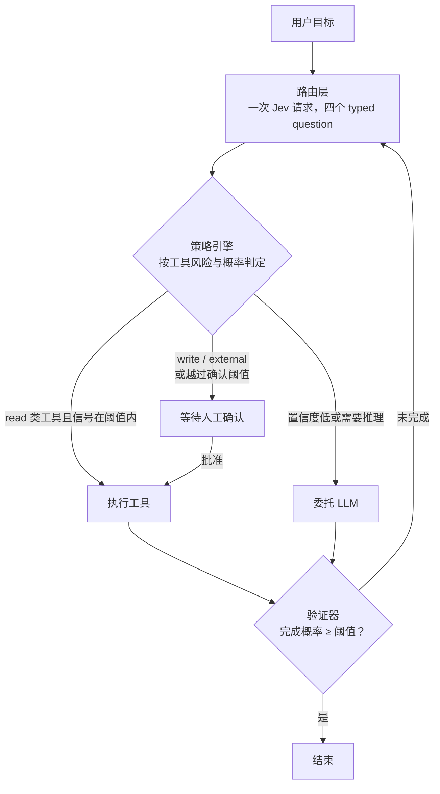

# JevRouter

[](https://github.com/HangChi/JevRouter/actions/workflows/ci.yml)
[](LICENSE)
[](pyproject.toml)
[](apps/web/package.json)

> 让 LLM 负责理解，让 Jev 负责判断，让代码负责控制。

大多数 Agent 把「决定下一步做什么」和「执行下一步」交给同一个模型：它读目标、它挑工具、它填参数、它把动作执行掉。于是「模型说要做」就等于「做了」，而唯一的护栏是一句写在系统提示里的「请谨慎」。

JevRouter 把这三件事拆给三个角色，其中一个不是模型：

| 角色 | 负责 | 不负责 |
| --- | --- | --- |
| **LLM** | 理解目标、拆解任务、生成内容与工具参数 | 决定做什么、能否执行 |
| **Jev** | 在有限候选动作上给出带概率的选择、风险分、是否需要确认 | 执行、授权 |
| **代码** | 策略判定、工具执行、结果验证、预算与 trace | 自由发挥 |

关键的一句：**模型输出只是输入，不授予任何执行权限。** 决定「能不能做」的永远是本地策略引擎。

## 架构



验证器说没完成时会回到路由层继续；但如果状态与上一步完全相同（没有任何推进），运行直接以 `failed` 停下并留下诊断——把同一份 payload 反复发给 provider 直到预算耗尽，只会把一次卡住变成一次昂贵的卡住。

路由层只问一次，同时拿到四件事——这是整个设计里最省事的一步：

```json
{
  "next_action":           "choice → 哪个动作，附带各候选概率",
  "risk":                  "score  → 0–4 的风险分",
  "requires_confirmation": "noul   → 是否需要人工确认的概率",
  "needs_reasoning":       "noul   → 是否需要更深推理的概率"
}
```

策略引擎的判定顺序是有意的：**控制动作 → 未注册拦截 → 工具风险下限 → 概率阈值**。也就是说，只要工具声明为 `write` 或 `external`，一律要求确认，与模型给出的分数无关；阈值只对 `read` 类工具起作用。

## 实测

53 条版本化用例，Jev `jev-latest` 对 `step-5-preview` 基线：

| 指标 | Jev | LLM 基线 |
| --- | --- | --- |
| 期望动作命中 | 92.5% | 96.2% |
| 平均延迟 | ~1.0 s | ~4.0 s |
| 自动执行 / 请人确认 / 委托 | 24 / 16 / 13 | — |
| 应确认用例的实际触发 | 16 / 17 | — |

延迟低是因为一次决策只发一个请求、输出 100 多个 token；准确率略低是因为 `ask_user` 偶尔兜底过度——剩余 5 条错误全部属于这一类，不是阈值能解决的。

三个数字背后是这条修复链：确认触发 0/17 → 16/17（规则实现分裂，架构问题）；命中 81.1% → 92.5%（候选描述写的是实现而不是能力边界）；升级率 62.3% → 50.9%（唯一一条有数据支撑的阈值改动）。完整推导见 [阈值校准](docs/calibration.md)。

## 快速开始

```sh
git clone https://github.com/HangChi/JevRouter.git && cd JevRouter
uv sync --all-groups
cp .env.example .env          # 填 JEV_API_KEY 与 JEV_MODEL

uv run --env-file .env uvicorn apps.api.app:create_app --factory --port 8000
```

```sh
curl -s -X POST http://127.0.0.1:8000/tasks \
  -H 'content-type: application/json' \
  -d '{"goal": "计算 (12 + 8) * 3"}'
```

五分钟走完整链路（含确认、仪表盘、评测）：[**快速开始**](docs/quickstart.md)。

没有 Jev 凭证也能看代码与跑测试——测试全部使用 HTTP mock，不产生任何真实调用。

## 项目结构

```text
.
├── jev_router/            # 与 Web/API 框架无关的 Agent 核心
│   ├── clients/           #   Jev 与 LLM 适配器，隔离供应商 schema
│   ├── policy.py          #   策略引擎：唯一判断「能不能执行」的地方
│   ├── router.py          #   一次请求拿四个 typed question
│   ├── runner.py          #   有界的 route/policy/execute/verify 循环
│   └── tools/             #   工具协议与五个 MVP 工具
├── apps/
│   ├── api/               # FastAPI 边界、SQLite trace、依赖装配
│   └── web/               # Next.js 仪表盘（运行 / 评测 / 策略三页）
├── evals/                 # 固定用例、LLM 基线、指标、阈值校准
├── docs/                  # 架构、配置、API、校准、安全、排查
└── specs/                 # 十三个阶段的规格与任务记录
```

核心包不依赖 FastAPI 或任何前端框架；`apps/api/` 只做校验与装配；`apps/web/` 只做展示。这条边界保证了核心逻辑可以在不启动服务的情况下完整测试。

## 文档

| 我想… | 读这个 |
| --- | --- |
| 五分钟把它跑起来 | [快速开始](docs/quickstart.md) |
| 知道每个环境变量的含义 | [配置参考](docs/configuration.md) |
| 调接口 / 看懂返回的字段 | [HTTP API 参考](docs/api.md) |
| 调策略阈值，或想知道为什么不该乱调 | [阈值校准](docs/calibration.md) |
| 理解模块边界与设计取舍 | [架构与模块边界](docs/architecture.md) |
| 知道哪些操作需要确认、为什么 | [安全与策略边界](docs/security.md) |
| 了解实现细节与实测契约 | [开发与验证约定](docs/development.md) |
| 出错了 | [故障排查](docs/troubleshooting.md) |
| 手工验收仪表盘 | [Web 手动验证清单](docs/web-manual-checks.md) |
| 参与开发 | [参与开发](CONTRIBUTING.md) |
| 最初的设计动机 | [原始产品设计草案](doc.md) |

## 现状与限制

**能跑的**：五工具、四问题路由、可配置策略、参数合成、人工确认（绑定参数摘要与 TTL）、有界执行循环、SQLite trace、FastAPI 边界、Next.js 仪表盘、53 条用例的评测与对比、零成本的阈值校准、CI 与双镜像。

**刻意没做的**：

- `web_search` 与 `send_mock_email` 是本地 mock，按设计不建立外部连接。真实集成要单独评估 SSRF、授权与审计。
- 没有速率限制与请求配额，那属于反向代理层。
- 确认没有独立的审计流水表，只落在 trace 与任务诊断里。
- 不引入 LangChain / LangGraph：这个项目的核心命题就是路由与策略怎么工作，套上框架之后关键逻辑反而藏在框架里。

**已知的短板**：剩余 5 条评测错误全部是 `ask_user` 兜底过度；53 条用例覆盖不够，阈值校准的结论也受此限制。下一步是扩用例集，而不是继续调参。

## 许可证

[MIT](LICENSE)
